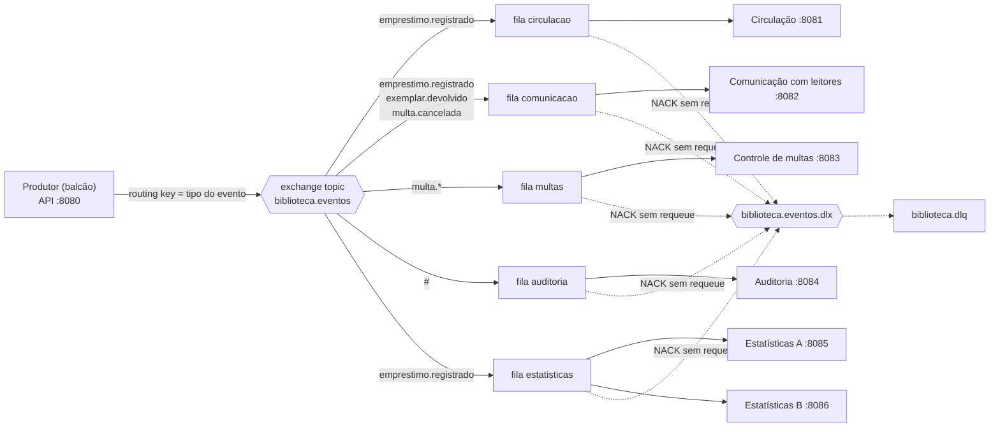

# Biblioteca universitária: mensageria com RabbitMQ (Tema 05) 

**Disciplina:** Sistemas Distribuídos e Cloud Computing
**Integrante:** [Elton Gabriel Milani da Silva – 268925]

Uma aplicação produtora (o "balcão") publica fatos da biblioteca; cinco responsabilidades de consumo reagem de forma independente. Java 17, Spring Boot 3, RabbitMQ 3.13 e PostgreSQL 16.

## 1. Diagrama



## 2. Matriz de roteamento (evento × consumidor)

| Evento (routing key) | Circulação | Comunicação | Multas | Auditoria | Estatísticas |
|---|:-:|:-:|:-:|:-:|:-:|
| Empréstimo registrado (`emprestimo.registrado`) | X | X | | X | X |
| Exemplar devolvido (`exemplar.devolvido`) | | X | | X | |
| Multa aplicada (`multa.aplicada`) | | | X | X | |
| Multa cancelada (`multa.cancelada`) | | X | X | X | |

Efeito de cada consumidor: **Circulação** registra a saída do exemplar (leitor + data prevista); **Comunicação** registra o aviso ao leitor; **Multas** registra multas aplicadas/canceladas (referência e valor); **Auditoria** mantém o histórico por id, tipo e horário; **Estatísticas** conta empréstimos por categoria (2 instâncias).

## 3. Contrato JSON
Campos comuns: `eventId` (UUID único), `tipo` (= routing key), `ocorridoEm` (ISO-8601 UTC), `dados` (conteúdo do fato).

```json
{ "eventId": "9f1c2b7e-4d3a-4c55-9a10-1e2f3a4b5c6d", "tipo": "emprestimo.registrado",
  "ocorridoEm": "2026-11-25T14:00:00Z",
  "dados": { "emprestimoId": "E1001", "exemplarId": "X123", "titulo": "Livro de Tecnologia",
             "categoria": "Tecnologia", "leitorId": "L200", "dataPrevistaDevolucao": "2026-12-09" } }
```
```json
{ "eventId": "...", "tipo": "exemplar.devolvido", "ocorridoEm": "...",
  "dados": { "emprestimoId": "E1001", "exemplarId": "X123", "leitorId": "L200", "dataDevolucao": "2026-12-05" } }
```
```json
{ "eventId": "...", "tipo": "multa.aplicada", "ocorridoEm": "...",
  "dados": { "multaId": "M300", "leitorId": "L200", "valor": 12, "motivo": "Atraso na devolucao" } }
```
`multa.cancelada` tem os mesmos campos de `multa.aplicada`.

## 4. Principais decisões técnicas
| Decisão | Justificativa |
|---|---|
| **Exchange topic** | Cobre os 3 padrões do trabalho: seleção por evento (chave exata), acompanhamento de família (`multa.*`) e recebimento abrangente (`#`). |
| **direct (alternativa)** | Só chave exata: acompanhar a família exigiria um binding por tipo e alteração a cada fato novo; auditoria exigiria um binding por chave. |
| **fanout (alternativa)** | Entrega tudo a todos, ignora a chave: não há seleção por evento nem por família (Circulação receberia multas). |
| **Uma fila durável por responsabilidade** | Cada consumidor tem sua cópia do evento e acumula mensagens se estiver parado, sem afetar os outros. |
| **Fila única com 2 instâncias (Estatísticas)** | Consumidores concorrentes: cada mensagem vai a só uma instância (1 execução por evento). `prefetch=1` espalha melhor o trabalho. |
| **Mensagem persistente + fila durável** | Sobrevivem a reinício do broker. |
| **ACK manual após o commit** | O ACK só ocorre depois do efeito gravado; queda antes do ACK = reentrega, não perda. |
| **Idempotência por (consumidor, eventId)** | PK na tabela `eventos_processados`, na mesma transação do efeito: evento duplicado é ignorado e confirmado. |
| **NACK sem requeue + DLX/DLQ** | Falha de processamento não gera loop infinito de reentrega. |
| **Evento novo da família** | `multa.paga` já casa com `multa.*` e `#`, sem alterar código nem bindings. |
| **Evento sem regra específica** | Não vai aos consumidores específicos, mas a Auditoria (`#`) sempre o recebe: nenhum fato se perde. |
| **Um projeto, 6 processos (perfis Spring)** | Cada papel inicia e para de forma independente, sem duplicar código de infraestrutura. |

## 5. Como executar
Requisitos: Java 17, Maven, Docker.
```bash
docker compose up -d                       # RabbitMQ (painel :15672, guest/guest) + PostgreSQL
mvn clean package -DskipTests
# um terminal por processo; na 1a vez suba um de cada vez (criação das tabelas)
J=target/biblioteca-mensageria-1.0.0.jar
java -jar $J --spring.profiles.active=produtor                         # :8080
java -jar $J --spring.profiles.active=circulacao                       # :8081
java -jar $J --spring.profiles.active=comunicacao                      # :8082
java -jar $J --spring.profiles.active=multas                           # :8083
java -jar $J --spring.profiles.active=auditoria                        # :8084
java -jar $J --spring.profiles.active=estatisticas --instancia=A       # :8085
java -jar $J --spring.profiles.active=estatisticas --instancia=B --server.port=8086
```
Parar tudo: `Ctrl+C` em cada processo e `docker compose down -v`.

## 6. Configuração reproduzível do broker
- **Automática:** a topologia é declarada em código (`Topologia.java`) por todos os processos, de forma idempotente, ao iniciar.
- **Manual/documentada:** `broker/definitions.json` descreve exchanges, filas e bindings. Para importar: painel `:15672` → *Overview* → *Import definitions*.

## 7. Procedimento para reproduzir os testes
Produtor: `P=http://localhost:8080/eventos`. Efeitos em `http://localhost:<porta>/consulta/<tabela>`.

**T1 – Roteamento** (prever antes de publicar)
```bash
curl -X POST $P/emprestimo-registrado   # esperado: circulacao, comunicacao, auditoria, estatisticas
curl -X POST $P/exemplar-devolvido      # esperado: comunicacao, auditoria
curl -X POST $P/multa-aplicada          # esperado: multas, auditoria
curl -X POST $P/multa-cancelada         # esperado: comunicacao, multas, auditoria
```
Conferir: `:8081/consulta/circulacao_saidas`, `:8082/consulta/avisos`, `:8083/consulta/multas`, `:8084/consulta/auditoria`, `:8085/consulta/estatisticas` e as filas no painel.

**T2 – Trabalho concorrente** (instâncias A e B no ar)
```bash
for i in $(seq 1 10); do curl -s -X POST $P/emprestimo-registrado > /dev/null; done
```
Conferir `:8085/consulta/estatisticas_log` (coluna `instancia`): os 10 eventos divididos entre A e B, sem exigir divisão igual; Circulação e Comunicação têm os mesmos 10.

**T3 – Interrupção e recuperação**
1. `Ctrl+C` no processo `comunicacao`.
2. `curl -X POST $P/emprestimo-registrado`
3. Circulação, Auditoria e Estatísticas processam; no painel, `biblioteca.comunicacao` mostra 1 mensagem *Ready*.
4. Religar `comunicacao`: a fila zera e o aviso aparece em `:8082/consulta/avisos`.

**T4 – Duplicidade**
```bash
BODY='{"emprestimoId":"E9999","exemplarId":"X999","titulo":"Teste","categoria":"Teste-Duplicidade","leitorId":"L999","dataPrevistaDevolucao":"2026-12-31"}'
for i in 1 2; do curl -s -X POST "$P/emprestimo-registrado?eventId=evento-dup-001" -H 'Content-Type: application/json' -d "$BODY"; done
```
Conferir `:8085/consulta/estatisticas`: `Teste-Duplicidade` = **1**. Os logs mostram um `PROCESSOU` e um `IGNOROU DUPLICADO`, ambos com ACK.

`./testes.sh` executa T1, T2 e T4 em sequência.

## 8. Observações
- A especificação diz que Comunicação registra aviso de "aplicação de multa", mas só recebe `multa.cancelada`; o aviso gravado para esse evento é do tipo MULTA ("multa cancelada").
- Limitação: o ACK ocorre após o commit; se o consumidor cair entre os dois, a mensagem é reentregue (entrega *at-least-once*) e a idempotência garante o efeito único. A garantia entre gravação no banco e publicação (outbox) não faz parte do escopo.
